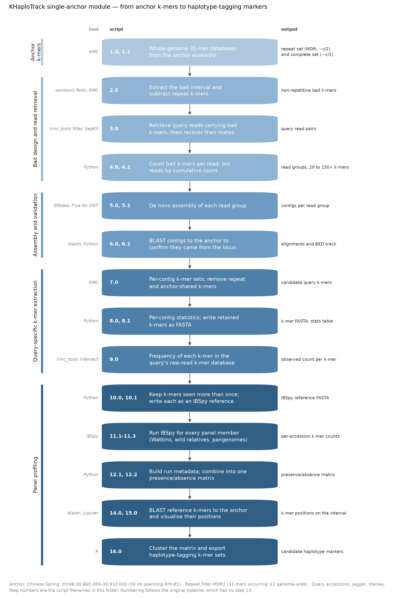

# KHaploTrack : Single-anchor module

Generating haplotype-specific *k*-mer markers for a locus in an accession that has no genome
assembly. The idea: use an assembled genome as an **anchor**, take *k*-mers from the anchor interval
as bait, pull the matching reads out of a query accession, assemble them, keep the *k*-mers unique to
the query, and score those *k*-mers for presence or absence across a wheat diversity panel.

**Worked example in this folder:** Chinese Spring anchor, `chr4B:30860000-30910000`. A 50 kb
interval spanning *Rht-B1*, with the repeat filter set to MDR2 and `jagger` and `stanley` as the
query accessions. Every script is configured for that run, so the whole module can be read as one
continuous analysis.

## The steps

Scripts are numbered in run order. An `N.0` script is the step itself; an `N.1` script is a SLURM
wrapper that passes variables to the Python module it sits beside.

| Script | What it does |
|---|---|
| `1.0`, `1.1` | Build whole-genome 31-mer databases for the anchor: a repeat set (*k*-mers occurring at least twice, `-ci2`) and the complete set (`-ci1`). `1.1` does the same for the ten pangenome assemblies. |
| `2.0` | Cut the bait interval out of the anchor with `samtools faidx`, build its 31-mer database, and subtract the repeat set. What remains are bait *k*-mers that are non-repetitive genome-wide. |
| `3.0` | Use those bait *k*-mers to pull reads out of each query accession's raw sequencing data, then recover each read's mate so pairs stay intact for assembly. |
| `4.0`, `4.1` | Count how many bait *k*-mers each retrieved read carries and bin the reads into cumulative groups from 20 up to 150+ *k*-mers. More bait *k*-mers in a read means stronger evidence it came from the target interval. |
| `5.0`, `5.1` | Assemble each read group into contigs with SPAdes (`5.1` is the Oxford Nanopore alternative using Flye). Assembling each bin separately shows how contig quality responds to the stringency of read selection. |
| `6.0`, `6.1` | BLAST the contigs back to the anchor to confirm they came from the expected locus, and convert the hits to a BED track for viewing. This is the validation step, correctly assembled contigs align to the anchor interval at high identity. |
| `7.0` | Split each contig into its own *k*-mer set, then remove *k*-mers found in the genome-wide repeat library and *k*-mers shared with the anchor genome. What survives is specific to the query. |
| `8.0`, `8.1` | Count repeat and query-specific *k*-mers per contig, and write the retained *k*-mers to FASTA. Each header encodes query genotype, *k*-mer threshold, contig ID, contig length and *k*-mer number, so every *k*-mer can be traced back to its contig. |
| `9.0` | Intersect the candidate *k*-mers with the query's raw-read *k*-mer database, giving the observed count of each *k*-mer in the reads. This is how sequencing-error *k*-mers are identified. |
| `10.0`, `10.1` | Keep *k*-mers observed more than once in the raw reads, and write each surviving *k*-mer as an individual IBSpy reference sequence. |
| `11.1`-`11.3` | Run IBSpy for every member of the panel against those reference *k*-mers: 827 Watkins landraces (`11.1`), 97 wild relatives (`11.2`), and pangenome and modern cultivars (`11.3`). IBSpy reports how many reference *k*-mers it observes per accession, which is used here as a presence/absence call. |
| `12.1`, `12.2` | Build the run metadata file and combine the per-accession outputs into a single presence/absence matrix, with a *k*-mer sum giving the number of accessions carrying each *k*-mer. |
| `14.0`, `15.0` | BLAST the reference *k*-mers back to the respective assembled parent contig sequence to place each one on the interval, and plot the resulting positions and alignment metrics. |
| `16.0` | Cluster the presence/absence matrix (Jaccard distance, average linkage) with *k*-mers ordered by their position on the interval, and export the clustered *k*-mer sets. These are the candidate haplotype-tagging markers. |

The numbering is inherited from the original pipeline and **has no step 13**.

## Running it

Every `.sh` file is a SLURM batch script for the John Innes Centre HPC; the Python steps run inside
a Singularity image. Query accessions and anchor genomes are chosen by a SLURM array index into a
bash array declared near the top of each script, so the array range and the accession list must
agree. The configuration variables, `workDir`, `genome`, `region`, `cultivars`, sit together at
the top of each file.

`16.0` is the only step that runs locally rather than on the cluster; its `work_dir` points at a
local analysis directory.

**These scripts are not portable as they stand.** Paths, module names and Singularity image names
are specific to that cluster, and the input data is not in this repository. The wheat genome
assemblies, the raw reads for the three panels, and the precomputed KMC *k*-mer databases all live in
institutional storage. The module is published as the record of how the analysis was run.

## Software

KMC v3.1.1, samtools v1.18, SeqKit v0.12.0, SPAdes v3.13.1, Flye v2.7.1, BLAST+ v2.12.0, minimap2,
[IBSpy](https://github.com/Uauy-Lab/IBSpy) v0.3.1, Python 3, R.
